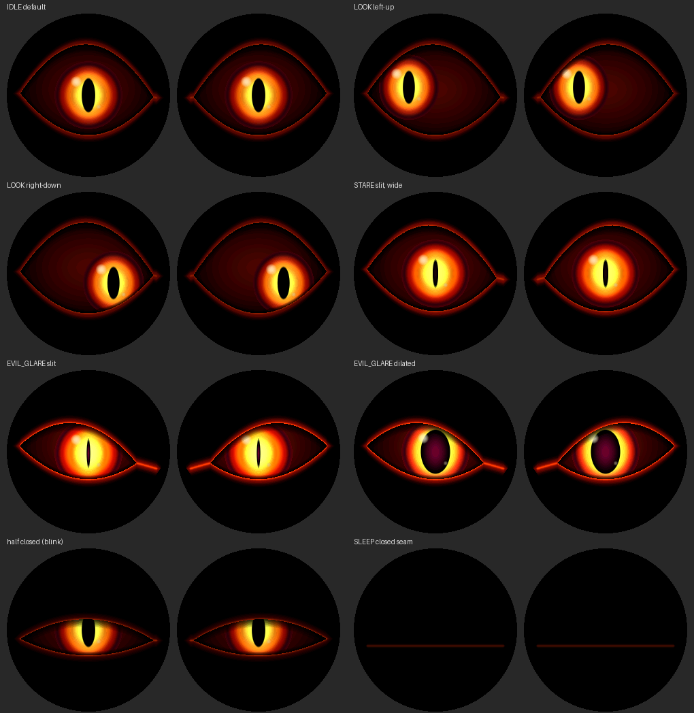
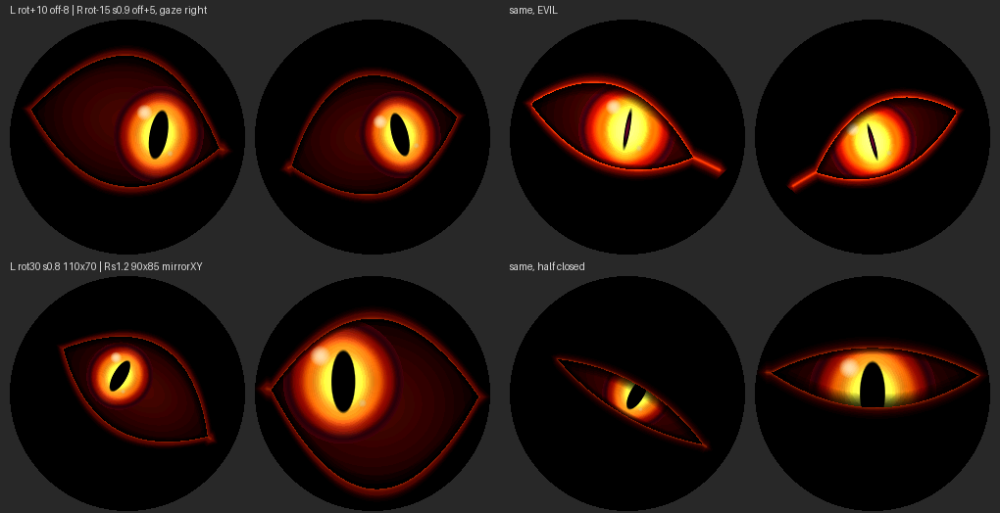

# Pumpkin Demon Eyes – animierte Dämonenaugen für den Halloween-Kürbis

[English](README.md) | **Deutsch**

Zwei runde 1,28"-TFTs (GC9A01, 240 × 240) an einem **Seeed Studio XIAO ESP32-C3** zeigen zwei
leuchtende, dämonische Augen. Sie blinzeln, schauen umher, starren, glühen bösartig auf und
schlafen ein. Das alles läuft autonom, ohne Sensoren und ohne WLAN.

Die Augen werden **vollständig prozedural** gezeichnet: Jeder Pixel wird aus Formeln
berechnet (Lidkurven, Ellipsen, Farbverläufe), es gibt keine GIFs, Bitmaps oder Bildsequenzen.
Position, Größe, Drehung und Spiegelung jedes Auges stellst du **ausschließlich in
`src/Config.h`** ein, passend zur Geometrie deines 3D-gedruckten Kürbisses.



*Bild: am PC berechnete Vorschau des Renderers, kein Foto. Je Paar links Display 1, rechts
Display 2, mit runder Maske wie auf dem Glas.*

---

## Inhalt

1. [Stand des Projekts](#1-stand-des-projekts)
2. [Hardware](#2-hardware)
3. [Anschlussplan und Pinbelegung](#3-anschlussplan-und-pinbelegung)
4. [Versorgungsspannung und Pegel](#4-versorgungsspannung-und-pegel)
5. [Warum diese Pins? (Strapping-Pins, SPI-Takt)](#5-warum-diese-pins)
6. [Bibliotheksauswahl](#6-bibliotheksauswahl)
7. [Installation, Kompilieren, Upload](#7-installation-kompilieren-upload)
8. [Betriebsmodi: Test, Kalibrierung, Animation](#8-betriebsmodi)
9. [Augen ausrichten – nur über `Config.h`](#9-augen-ausrichten)
10. [Farben, Leuchten, Animation anpassen](#10-farben-leuchten-animation)
11. [Software-Architektur](#11-software-architektur)
12. [Rendering, Performance, Speicher](#12-rendering-performance-speicher)
13. [Bekannte Einschränkungen](#13-bekannte-einschränkungen)

---

## 1. Stand des Projekts

| Punkt | Status |
|---|---|
| PlatformIO-Build (`pio run`) | **erfolgreich**: RAM 33 220 B (10,1 %), Flash 372 030 B (28,4 %). Auch mit `-Wall -Wextra -Wformat -Wsign-compare` keine Warnungen im Projektcode. |
| Test auf echter Hardware | **erfolgreich**: XIAO ESP32-C3 mit zwei GC9A01-Modulen, gemeinsamer SPI-Bus, gemeinsames DC/RST |
| Bildrate | flüssig mit dem Standard-Limit von **24 FPS** (`TARGET_FPS`), SPI-Takt 40 MHz |

Bei einem neuen Aufbau nach dem ersten Flashen zuerst den
[Hardwaretest](#81-hardwaretest-appmodehardwaretest) laufen lassen.

---

## 2. Hardware

| Komponente | Details |
|---|---|
| Mikrocontroller | Seeed Studio XIAO ESP32-C3: RISC-V Single-Core, 160 MHz, 400 KB SRAM, 4 MB Flash, **keine FPU** |
| Display 1 (linkes Auge) | 1,28" rund, GC9A01, 240 × 240, 4-Draht-SPI |
| Display 2 (rechtes Auge) | identisch |
| Versorgung | USB-C (5 V, z. B. Powerbank) |

„Links“ und „rechts“ meinen in diesem Projekt immer die Sicht eines **Betrachters vor dem
Kürbis**. Display 1 ist das linke, Display 2 das rechte Auge.

---

## 3. Anschlussplan und Pinbelegung

Beide Displays hängen an **einem gemeinsamen SPI-Bus**. SCK, MOSI, DC und RST sind gemeinsam,
**jedes Display hat seine eigene CS-Leitung**. MISO wird nicht benötigt, weil die Displays nur
beschrieben werden.

> Die GC9A01-Module beschriften die SPI-Leitungen oft wie I²C: **SCL = SPI-Takt (SCK)**,
> **SDA = SPI-Daten (MOSI)**. Mit I²C hat das nichts zu tun.

### Display 1 – linkes Auge

| Display-Pin | XIAO-Pin | GPIO | Bemerkung |
|---|---|---|---|
| VCC | 3V3 | – | siehe [Abschnitt 4](#4-versorgungsspannung-und-pegel) |
| GND | GND | – | |
| SCL (SCK) | D4 | GPIO6 | **gemeinsam** mit Display 2 |
| SDA (MOSI) | D5 | GPIO7 | **gemeinsam** mit Display 2 |
| CS | D1 | GPIO3 | nur Display 1 |
| DC | D2 | GPIO4 | **gemeinsam** mit Display 2 |
| RST / RES | D3 | GPIO5 | **gemeinsam** mit Display 2 |
| BL / BLK (falls vorhanden) | D7 | GPIO20 | optional, standardmäßig aus (`PIN_BACKLIGHT = -1`), siehe Hinweis unten |

### Display 2 – rechtes Auge

| Display-Pin | XIAO-Pin | GPIO | Bemerkung |
|---|---|---|---|
| VCC | 3V3 | – | |
| GND | GND | – | |
| SCL (SCK) | D4 | GPIO6 | gemeinsam |
| SDA (MOSI) | D5 | GPIO7 | gemeinsam |
| CS | **D10** | **GPIO10** | nur Display 2 |
| DC | D2 | GPIO4 | gemeinsam |
| RST / RES | D3 | GPIO5 | gemeinsam |
| BL / BLK (falls vorhanden) | D7 | GPIO20 | optional, gemeinsam |

### Übersicht aller GPIOs

| XIAO | GPIO | Verwendung | Hinweis |
|---|---|---|---|
| D0 | GPIO2 | frei (nur `RST` rechts bei getrennten Leitungen) | **Strapping-Pin** |
| D1 | GPIO3 | CS Display 1 | |
| D2 | GPIO4 | DC (beide) | |
| D3 | GPIO5 | RST (beide) | |
| D4 | GPIO6 | SPI SCK (beide) | nativer FSPICLK-Pin (IO_MUX) |
| D5 | GPIO7 | SPI MOSI (beide) | nativer FSPID-Pin (IO_MUX) |
| D6 | GPIO21 | frei (nur `DC` rechts bei getrennten Leitungen) | UART-TX, zeigt beim Booten das ROM-Log |
| D7 | GPIO20 | Backlight (optional) | UART-RX, frei, weil Serial über USB läuft |
| D8 | GPIO8 | **frei** | Strapping-Pin |
| D9 | GPIO9 | **frei** | Strapping-Pin, BOOT-Taster |
| D10 | GPIO10 | CS Display 2 | |

Alle Pins stehen zentral in `src/Config.h` (`PIN_SPI_SCLK`, `PIN_SPI_MOSI`, `PIN_TFT_CS_LEFT`,
`PIN_TFT_CS_RIGHT`, `PIN_TFT_DC`, `PIN_TFT_RST`, `PIN_BACKLIGHT`, …).

### Skizze

```
                 XIAO ESP32-C3 (Draufsicht, USB oben)
                      ┌──────[USB-C]──────┐
     (frei)   D0/GPIO2│●                 ●│5V
  CS Disp.1   D1/GPIO3│●                 ●│GND ──────────── GND  Disp.1 + Disp.2
  DC beide    D2/GPIO4│●                 ●│3V3 ──────────── VCC  Disp.1 + Disp.2
  RST beide   D3/GPIO5│●                 ●│D10/GPIO10  CS Disp.2
  SCK beide   D4/GPIO6│●                 ●│D9/GPIO9    (frei, BOOT)
  MOSI beide  D5/GPIO7│●                 ●│D8/GPIO8    (frei, Strapping)
     (frei)  D6/GPIO21│●                 ●│D7/GPIO20   BL beide (optional)
                      └───────────────────┘
```

### Getrennte DC- oder RST-Leitungen (optional)

Gemeinsame DC/RST-Leitungen sind der Standard und funktionieren mit dieser Firmware. Wer sie
trotzdem trennen will, setzt in `Config.h` `SHARED_DC = false` und/oder `SHARED_RST = false`.
Display 2 nutzt dann `PIN_TFT_DC_RIGHT` (D6/GPIO21) bzw. `PIN_TFT_RST_RIGHT` (D0/GPIO2).

---

## 4. Versorgungsspannung und Pegel

**Prüfe dein konkretes Modul, bevor du Spannung anlegst.** GC9A01-Module gibt es in mehreren
Varianten:

- **Mit Spannungsregler** (häufig ein kleiner SOT-23-Regler, oft mit „662K“ beschriftet, auf der
  Rückseite; das Modul ist dann meist mit „3.3V/5V“ beschriftet): VCC darf 3,3 V oder 5 V
  bekommen. Waveshare gibt für sein 1,28"-Modul ebenfalls 3,3 V/5 V an.
- **Ohne Regler**: VCC geht direkt an das Panel. Hier sind **nur 3,3 V** zulässig.

Empfehlung: **VCC an den 3V3-Pin des XIAO**. Das funktioniert mit beiden Varianten. Zwei
Module ziehen zusammen typischerweise unter 100 mA (Waveshare nennt rund 31 mA pro Modul), der
3,3-V-Regler des XIAO liefert genug Strom, solange der ESP32-C3 ohne WLAN läuft.

**Logikpegel:** Der ESP32-C3 arbeitet mit 3,3-V-Logik, und die Logikeingänge des GC9A01 sind
für 3,3 V ausgelegt. Die Signalleitungen der Module sind in der Regel
**nicht 5-V-tolerant**. Deshalb nie einen 5-V-Mikrocontroller ohne Pegelwandler anschließen.
Pegelwandler sind beim XIAO **nicht nötig**.

**Hintergrundbeleuchtung (BL/BLK):**
- Viele Module schalten die LED über einen Transistor und haben einen Pull-up am BL-Pin. Lässt
  du BL offen, leuchtet das Display einfach. Das ist der Standard (`PIN_BACKLIGHT = -1`).
- Willst du die Helligkeit per PWM steuern, verbinde beide BL-Pins mit D7 und setze
  `PIN_BACKLIGHT = 20`. **Achtung:** Hat dein
  Modul **keinen** Transistor und führt BL direkt auf die LED, darf BL nicht direkt an einen
  GPIO. Nimm dann einen kleinen Transistor oder lege BL an 3V3.

**Versorgung im Kürbis:** USB-C-Powerbank am XIAO. Manche Powerbanks schalten bei sehr kleinem
Strom ab, mit zwei leuchtenden Displays ist das aber selten ein Problem.

---

## 5. Warum diese Pins?

**Strapping-Pins gemieden.** Laut Seeed-Wiki und ESP32-C3-Datenblatt sind GPIO2, GPIO8 und
GPIO9 Strapping-Pins. Ihr Pegel beim Reset entscheidet über den Boot-Modus. GPIO9 hängt am
BOOT-Taster: Low beim Start bedeutet Download-Modus. Ein angeschlossenes Display könnte diese
Pegel verfälschen und den Start oder den Upload verhindern. Deshalb nutzt die
Standardbelegung **keinen** dieser drei Pins. Insbesondere liegt SCK **nicht** auf D8/GPIO8,
obwohl das Seeed-Pinout dort „SCK“ angibt.

**Native SPI-Pins für den Takt.** Beim ESP32-C3 sind GPIO6 (FSPICLK) und GPIO7 (FSPID) die
festen IO_MUX-Pins des SPI2-Controllers. Laut ESP-IDF-Doku sind über IO_MUX 80 MHz möglich, über
die frei routbare GPIO-Matrix (D8/D10) nur 40 MHz. Die Firmware startet mit sicheren
**40 MHz**. Die native Pinwahl lässt aber den Weg zu 80 MHz offen
([Abschnitt 12.3](#123-turbo-80-mhz-spi-ungetestet)).

**MISO nicht verwendet.** Die Displays werden nur beschrieben. D9 (Strapping-Pin + BOOT) bleibt
dadurch frei.

---

## 6. Bibliotheksauswahl

**Gewählt: [LovyanGFX](https://github.com/lovyan03/LovyanGFX) 1.2.35.**
Die verwendeten Klassen und Funktionen habe ich im Quellcode dieser Version nachgeschlagen.

| Anforderung | LovyanGFX |
|---|---|
| GC9A01 | eigene Panelklasse `lgfx::Panel_GC9A01` (mit GC9A01-spezifischem Init und „kein NOP“-Workaround) |
| ESP32-C3 | `lgfx::Bus_SPI` mit GDMA-DMA für den C3 |
| Zwei unabhängige Displays | beliebig viele `LGFX_Device`-Instanzen, komplett **im Code** konfiguriert, keine globale Setup-Datei |
| Gemeinsamer SPI-Bus | beide Panels können **dasselbe** `Bus_SPI`-Objekt nutzen (gemeinsames DC) |
| Effiziente Übertragung | `setWindow()` + `writePixelsDMA()` schicken eigene Pixelpuffer per DMA direkt, ohne Kopie |
| Formen und Text | `drawLine`, `drawCircle`, `fillTriangle`, `drawString` … für Test- und Kalibrierbilder |
| RAM | kein Framebuffer nötig, LovyanGFX reserviert nur einen DMA-Zeilenpuffer (≈ 480 B) pro Panel |

**Verworfen:**
- **TFT_eSPI**: unterstützt GC9A01 und den ESP32-C3. Die Konfiguration steckt aber global in
  `User_Setup.h` und beschreibt genau *ein* Display. Zwei Displays gehen nur über manuelles
  CS-Umschalten, was laut Autor nicht vorgesehen ist. Positionen und Rotationen pro Display
  lassen sich so kaum sauber getrennt pflegen.
- **Arduino_GFX**: kann GC9A01 und mehrere Displays ebenfalls. LovyanGFX habe ich bevorzugt, weil
  sich dort die DMA-Ausgabe eigener Puffer und das Verhalten bei geteiltem Bus im Quellcode
  vollständig nachvollziehen ließen.

**Zusätzliche Konfigurationsdatei?** Nein. LovyanGFX wird in `src/DisplayManager.cpp`
konfiguriert, alle Werte kommen aus `src/Config.h`.

**Drei Eigenheiten, die die Firmware berücksichtigt** (im Quellcode der Bibliothek geprüft):
1. **Gemeinsamer Reset:** LovyanGFX zieht beim `init()` jedes Panels dessen RST-Pin. Bei einer
   gemeinsamen RST-Leitung würde das Initialisieren von Display 2 Display 1 wieder zurücksetzen.
   Die Panels bekommen deshalb `pin_rst = -1`, und der `DisplayManager` erzeugt **einen**
   Reset-Puls für beide.
2. **Gemeinsames DC:** Beide Panels teilen sich **ein** `Bus_SPI`-Objekt. So bleibt der
   DMA-Zustand des Busses konsistent.
3. **SPI-Sperre:** Die Transaktionssperre des Arduino-Cores ist nicht rekursiv. Es darf nie für
   beide Displays gleichzeitig eine Transaktion offen sein, sonst hängt das Programm. Der
   `DisplayManager` schließt deshalb immer erst die eine Transaktion, bevor er die andere öffnet.

---

## 7. Installation, Kompilieren, Upload

### 7.1 PlatformIO

1. [Visual Studio Code](https://code.visualstudio.com/) installieren.
2. In VS Code die Erweiterung **PlatformIO IDE** installieren.
3. Den Ordner `Pumpkin-Demon-Eyes` in VS Code öffnen (*File → Open Folder*).

### 7.2 Bibliotheken

Nichts manuell installieren: `platformio.ini` enthält

```ini
lib_deps = lovyan03/LovyanGFX@^1.2.35
```

PlatformIO lädt LovyanGFX beim ersten Build automatisch herunter. Die Plattform `espressif32`
(6.x, Arduino-Core 2.0.17) wird ebenfalls automatisch installiert.

### 7.3 Kompilieren

In der PlatformIO-Leiste auf **Build** (✓) klicken oder im Terminal:

```bash
pio run
```

### 7.4 Upload auf den XIAO ESP32-C3

XIAO per USB-C anschließen, dann **Upload** (→) oder:

```bash
pio run -t upload
```

Erscheint kein Port oder schlägt der Upload fehl: **BOOT-Taster halten, RESET kurz drücken,
BOOT loslassen** und erneut hochladen. Danach einmal RESET drücken.

### 7.5 Serieller Monitor

```bash
pio device monitor
```

Die Ausgabe läuft über USB-CDC mit 115200 Baud. Du siehst den Init-Bericht, die
Geometrie-Auswertung beider Augen, jeden Zustandswechsel und alle 5 s eine Statistik:

```
[stats] 24.0 fps | frame avg 30.1 ms max 33.8 ms | render L 14.8 ms R 14.9 ms | heap free … | IDLE
```

*(Die Zahlen sind ein Beispiel für das Format, keine Messung.)*

---

## 8. Betriebsmodi

Den Modus wählst du in `src/Config.h`:

```cpp
constexpr AppMode APP_MODE = AppMode::Animation;   // oder HardwareTest, Calibration
```

### 8.1 Hardwaretest (`AppMode::HardwareTest`)

Ein Durchlauf in sechs Schritten, jeder Schritt wird seriell angekündigt. Danach beginnt der Test
von vorn.

| Schritt | Anzeige | Was du prüfst |
|---|---|---|
| 1 | Display 1 **rot**, Display 2 schwarz | Display 1 und seine CS-Leitung (GPIO3) |
| 2 | Display 1 schwarz, Display 2 **grün** | Display 2 und seine CS-Leitung (GPIO10) |
| 3 | Display 1 **blau**, Display 2 **gelb** | unabhängige Ansteuerung, Farbreihenfolge (`DISPLAY_RGB_ORDER`), Invertierung (`DISPLAY_INVERT`) |
| 4 | Pfeil „TOP“, „L1“/„R2“, gelbes Quadrat oben links | Display-Rotation (`DISPLAY_ROTATION_*`) |
| 5 | Auge + Kalibrier-Overlay | Position, Radius, Augen-Rotation, Spiegelung |
| 6 | Animations-Demo aller Zustände | IDLE, LOOK_AROUND, BLINK, DOUBLE_BLINK, STARE, EVIL_GLARE, SLEEP, WAKE_UP inkl. FPS-Ausgabe |

Typische Fehlerbilder:
- **Beide Displays zeigen dasselbe:** CS-Leitungen vertauscht oder verbunden.
- **Ein Display bleibt dunkel:** CS, VCC/GND oder Backlight dieses Displays prüfen.
- **Farben invertiert (schwarz wird weiß):** `DISPLAY_INVERT` umschalten.
- **Rot und Blau vertauscht:** `DISPLAY_RGB_ORDER = true`.
- **Nur Rauschen:** SCK/MOSI vertauscht oder `SPI_WRITE_FREQ_HZ` zu hoch.

### 8.2 Kalibrierung (`AppMode::Calibration`)

Für die Montage im Kürbis. Jedes Display zeigt ein **ruhendes Auge** mit Overlay. Alle 1,8 s
wechselt die Blickrichtung (Mitte, links, rechts, oben, unten, diagonal, halb geschlossen,
„evil“), so siehst du auch die Bewegungsgrenzen der Pupille.

| Farbe | Element |
|---|---|
| grau | sichtbarer Kreis des Displays, Display-Mittelkreuz, Display-Achsen (nicht gedreht) |
| cyan (links) / magenta (rechts) | Augenmittelpunkt (Kreis), Augenachsen (**drehen mit**), Augenumriss, Pupillen-Bewegungsgrenze (gedimmt) |
| Pfeil an der Augenachse | lokale **+x**-Richtung = innerer Augenwinkel (Nasenseite) des Designs; zeigt bei Spiegelung zur anderen Seite |
| Dreieck über dem Auge | „oben“ des Auges |
| orange | Bogen von der Display-Waagerechten zur Augenachse = eingestellte Augen-Rotation |
| gelb | Begrenzungsrahmen des tatsächlich gezeichneten Bereichs |
| Text | aktuelle Werte `c=`, `off=`, `r=`, `scale=`, `rot=`, `mirror=` |

Zusätzlich gibt die Firmware seriell für jedes Auge den Renderbereich aus. Sie **warnt**, wenn
das Auge über den sichtbaren Kreis hinausragt, also abgeschnitten wird.

### 8.3 Animation (`AppMode::Animation`)

Der Normalbetrieb. Nach dem Einschalten „erwacht“ der Kürbis (WAKE_UP), danach wechseln die
Zustände zufällig, aber nach festen Gewichten (siehe [10.4](#104-verhalten-und-zustände)).

---

## 9. Augen ausrichten

### 9.1 Die Parameter

Jedes Auge hat in `Config.h` einen eigenen Block:

```cpp
constexpr EyeGeometryConfig LEFT_EYE_CONFIG = {
    120, 120,         // centerX, centerY
    0.0f, 1.0f,       // rotationDeg, scale
    100.0f, 78.0f,    // radiusX, radiusY
    0, 0,             // offsetX, offsetY
    false, false      // mirrorX, mirrorY
};
```

| Parameter | Einheit | Bedeutung |
|---|---|---|
| `centerX`, `centerY` | Display-Pixel | Nominaler Augenmittelpunkt; 120/120 = Displaymitte |
| `offsetX`, `offsetY` | Display-Pixel | Montagekorrektur, wird **nach** der Drehung addiert; + = nach rechts/unten |
| `rotationDeg` | Grad | zusätzliche Drehung des Augenbilds; **+ = im Uhrzeigersinn** |
| `scale` | Faktor | gleichmäßige Größe (1,0 = Designgröße) |
| `radiusX` | Augen-Einheiten | halbe Breite der Augenöffnung (Abstand Mitte → Augenwinkel) |
| `radiusY` | Augen-Einheiten | Höhe des oberen Lidbogens; der untere ist `EYE_LOWER_LID_RATIO` (0,78) davon |
| `mirrorX`, `mirrorY` | – | spiegelt die **Form** des Auges (schräge Lider, innerer Augenwinkel) |

**Wie wirken Radius und Skalierung zusammen?** Die Größe auf dem Display ist
**`radius × scale`**. `radiusX`/`radiusY` bestimmen die **Form** (breit/schmal), `scale`
vergrößert oder verkleinert das ganze Auge samt Iris, Pupille, Halo und Lidrand. Doppelt oder
widersprüchlich ist das nicht: Die Form legst du über die Radien fest, das Einpassen über
`scale`.

**Reihenfolge der Transformation** (lokale Augenkoordinaten → Display), zentral in
`EyeTransform` (`src/EyeGeometry.cpp`) umgesetzt:

1. lokale Koordinate (u, v), Ursprung = Augenmitte
2. Spiegelung (`mirrorX`, `mirrorY`)
3. Skalierung (`scale`)
4. Rotation (`rotationDeg`, im Uhrzeigersinn)
5. Verschiebung auf (`centerX + offsetX`, `centerY + offsetY`)
6. Begrenzung auf das Display und den sichtbaren Kreis

Blick, Pupille, Blinzeln und Leuchten werden **lokal** berechnet, die Transformation passiert erst
beim Zeichnen. Deshalb kannst du die Geometrie beliebig ändern, ohne dass sich die Animation
ändert.

### 9.2 Konkrete Beispiele

Alle Beispiele ändern **nur** `Config.h`. Danach neu hochladen (`pio run -t upload`).

**Linkes Auge 8 Pixel nach oben:**
```cpp
constexpr EyeGeometryConfig LEFT_EYE_CONFIG = {
    120, 120,  0.0f, 1.0f,  100.0f, 78.0f,  0, -8,  false, false };
//                                           ^^^^ offsetY = -8
```

**Rechtes Auge 5 Pixel nach unten:**
```cpp
constexpr EyeGeometryConfig RIGHT_EYE_CONFIG = {
    120, 120,  0.0f, 1.0f,  100.0f, 78.0f,  0, 5,  true, false };
```

**Linkes Auge 10° im Uhrzeigersinn, rechtes 15° gegen den Uhrzeigersinn:**
```cpp
// links:  rotationDeg = 10.0f      rechts: rotationDeg = -15.0f
```

**Ein Auge auf 90 % verkleinern:** `scale = 0.9f`

**Ein Auge etwas breiter, das andere etwas schmaler:**
```cpp
// links:  radiusX = 106.0f        rechts: radiusX = 94.0f
```

**Ein Auge horizontal spiegeln:** `mirrorX = true`. Das rechte Auge ist ab Werk gespiegelt, damit
die schrägen Lider bei EVIL_GLARE symmetrisch zur Nase zeigen.

**Schräg eingesetzte Displayöffnung** (das ganze Display sitzt z. B. 12° verdreht und 6 px zu
weit rechts im Kürbis): Gleiche die Drehung mit `rotationDeg = -12.0f` aus und die Verschiebung
mit `offsetX = -6`. Steht das Display um 90° verdreht, nimm statt eines großen Winkels die
Display-Rotation (`DISPLAY_ROTATION_*`).

So sieht eine Auswahl dieser Einstellungen aus (am PC berechnete Vorschau):



### 9.3 Vorgehen nach der Montage

1. `APP_MODE = AppMode::HardwareTest` setzen und hochladen. Prüfen, dass beide Displays
   funktionieren und der Pfeil in Schritt 4 nach oben zeigt. Wenn nicht, `DISPLAY_ROTATION_LEFT`
   bzw. `_RIGHT` ändern.
2. `APP_MODE = AppMode::Calibration` setzen und hochladen.
3. Den Kürbis aus Betrachtersicht anschauen:
   - Mitte des Auges nicht in der Mitte der Öffnung → `offsetX`/`offsetY` ändern.
   - Augenachse schief zur Öffnung → `rotationDeg` ändern (+ = im Uhrzeigersinn).
   - Auge zu groß oder klein für die Öffnung → `scale` ändern; Auge zu breit oder zu hoch →
     `radiusX`/`radiusY` ändern.
   - Der Pfeil (innerer Augenwinkel) soll bei beiden Augen zur Nase zeigen, sonst `mirrorX`
     umschalten.
4. Seriell auf Warnungen achten (`eye area exceeds the visible circle …`).
5. Wenn alles passt: `APP_MODE = AppMode::Animation`.

### 9.4 Display-Rotation ≠ Augen-Rotation

| | Display-Rotation | Augen-Rotation |
|---|---|---|
| Parameter | `DISPLAY_ROTATION_LEFT`, `DISPLAY_ROTATION_RIGHT` | `rotationDeg` im `EyeGeometryConfig` |
| Werte | 0–3 = 0/90/180/270° im Uhrzeigersinn, 4–7 = zusätzlich gespiegelt | beliebig, z. B. 7,5° |
| Wirkung | dreht das ganze Koordinatensystem des Panels (Hardware, `setRotation()` von LovyanGFX) | dreht nur das gezeichnete Auge innerhalb des Displays |
| Zweck | grobe Einbaulage (Display steht auf dem Kopf, liegt quer) | Feinausrichtung an die Öffnung |

Die Augen-Rotation verändert weder die Display-Ausrichtung noch die SPI-Ausgabe noch die
Koordinaten von LovyanGFX. Sie existiert nur in der Transformation des Renderers.

**Standardwerte:** `DISPLAY_ROTATION_LEFT = 3` und `DISPLAY_ROTATION_RIGHT = 1`. Das passt zum
Referenz-Kürbis, in dem beide Displays um 90° gedreht eingebaut sind (links gegen, rechts im
Uhrzeigersinn). Stehen deine Displays aufrecht, setze beide Werte auf 0. Steht ein Bild auf dem
Kopf oder seitenverkehrt, tausche bei diesem Display 1 und 3.

### 9.5 Spiegelung und Blickrichtung

Eine Spiegelung kehrt die **Form** um (Lidschräge, innerer Augenwinkel, Lidnaht). Blickrichtung
und Lichtreflex bleiben dagegen **bildschirmtreu**: Schauen beide Augen „nach rechts“, schauen
sie auch gespiegelt beide nach rechts, und der Reflex sitzt bei beiden oben links. Dafür
rechnet `Eye::lookAt()` die gemeinsame Blickrichtung in das lokale System jedes Auges um.

Eine reine Drehung verändert die Blickrichtung **nicht** gesondert: Die Pupille bewegt sich im
lokalen System des gedrehten Auges, so wie es zu einem schräg eingesetzten Auge passt.

`mirrorY` dreht auch die Schließrichtung der Lider um, weil die Lidnaht dann oben liegt. Das ist
gewollt, wird aber selten gebraucht.

### 9.6 Sichtbarer Bereich

Die Firmware zeichnet nur Pixel innerhalb des Kreises `DISPLAY_VISIBLE_CENTER_X/Y`,
`DISPLAY_VISIBLE_RADIUS` (Standard 120/120, r = 120). Verdeckt dein Kürbis den Rand, kannst du
den Radius verkleinern. Liegt ein Auge teilweise außerhalb, wird es sauber abgeschnitten. Es gibt
keine Speicherzugriffe außerhalb gültiger Bereiche, weil die Zeilenbereiche vorab auf Display und
Kreis begrenzt werden. Extreme Werte für `scale`/`radius` begrenzt die Firmware automatisch und
meldet das seriell.

---

## 10. Farben, Leuchten, Animation

### 10.1 Farben

Alle Farben stehen als `0xRRGGBB` in `Config.h`, Abschnitt *COLOURS*:

| Konstante | Teil des Auges | Standard |
|---|---|---|
| `COLOR_BACKGROUND` | alles außerhalb des Auges | Schwarz |
| `COLOR_LID_RIM` | glühende Lidkante, Lidnaht beim Schlafen | Orange-Rot |
| `COLOR_HALO` | Schein rund um die Augenöffnung | dunkles Rot |
| `COLOR_SCLERA_CENTER` / `_EDGE` | Augapfel, Mitte und Rand | dunkles Blutrot → fast Schwarz |
| `COLOR_IRIS_INNER` / `_MID` / `_OUTER` / `_RIM` | Iris von innen nach außen | Gelb-Orange → Orange → Blutrot → dunkles Violett-Rot |
| `COLOR_PUPIL` | Pupille | Schwarz |
| `COLOR_PUPIL_CORE` | glühender Pupillenkern (EVIL_GLARE) | dunkles Violett-Rot |
| `COLOR_GLOW` | Licht rund um die Pupille | helles Gelb |
| `COLOR_HIGHLIGHT` | Lichtreflexe | warmes Weiß |

Beispiel für **grüne Hexenaugen**: `COLOR_IRIS_INNER = 0xD8FF40`, `COLOR_IRIS_MID = 0x60E000`,
`COLOR_IRIS_OUTER = 0x108000`, `COLOR_GLOW = 0xF0FFB0`, `COLOR_HALO = 0x0A5000`,
`COLOR_LID_RIM = 0x60FF20`.

### 10.2 Leuchten

| Konstante | Wirkung |
|---|---|
| `GLOW_INTENSITY_SCALE` | Gesamthelligkeit aller leuchtenden Teile |
| `GLOW_PUPIL_STRENGTH` | Licht um die Pupille |
| `GLOW_HALO_STRENGTH`, `GLOW_RIM_STRENGTH` | Halo bzw. Lidkante |
| `GLOW_FLICKER_AMOUNT` | glutartiges Flackern (0 = ruhig) |
| `GLOW_FIRE_RINGS`, `GLOW_FIRE_AMOUNT`, `GLOW_FIRE_SPEED` | nach außen wandernde Feuerringe in der Iris |
| `GLOW_IDLE`, `GLOW_STARE`, `GLOW_EVIL`, `GLOW_SLEEP` | Leuchtstärke je Zustand |
| `BACKLIGHT_BRIGHTNESS` | Hintergrundbeleuchtung (nur mit angeschlossenem BL-Pin) |

Das Leuchten entsteht über Farbverläufe in Lookup-Tabellen, nicht über aufwendige
Pixeloperationen ([Abschnitt 12](#12-rendering-performance-speicher)).

### 10.3 Geschwindigkeit

| Konstante | Wirkung |
|---|---|
| `ANIM_GAZE_SPEED` | Faktor für **alle** Augenbewegungen (0,7 = 30 % schneller, 1,5 = träger) |
| `ANIM_PUPIL_SPEED` | Faktor für Pupillenänderungen |
| `SACCADE_BASE_MS`, `SACCADE_MS_PER_UNIT` | schnelle Blicksprünge |
| `GLIDE_MS_MIN/MAX` | langsame, schleichende Blicke |
| `SNAP_MS` | aggressives Zucken mit Überschwingen |
| `MICRO_SACCADE_*` | winzige Fixationsbewegungen |
| `BLINK_*` | Dauer jeder Blinzelart, Intervall `BLINK_INTERVAL_MIN/MAX_MS`, `DOUBLE_BLINK_CHANCE` |
| `OPENNESS_MIN/MAX` | Bereich der normalen Augenöffnung (ohne Blinzeln und Schlafen) |
| `IDLE_OPENNESS_MIN/MAX` | Augenöffnung im Ruhezustand IDLE (Standard 0,70–0,82; kleiner = schläfriger, lauernder Blick) |
| `*_MS_MIN/MAX` | Dauer jedes Zustands |
| `RANDOM_SEED` | 0 = jedes Mal anders, sonst reproduzierbarer Ablauf |

### 10.4 Verhalten und Zustände

| Zustand | Verhalten |
|---|---|
| `IDLE` | ruhiger, lebendiger Blick, langsames Driften, gelegentliche Blicksprünge; manchmal eine **unheimliche Ruhephase** (keine Mikrobewegung, kein Blinzeln), die mit einem plötzlichen Sprung endet |
| `LOOK_AROUND` | Blicke in alle Richtungen (links, rechts, oben, unten, diagonal, Mitte, Zwischenpositionen) als schnelle Sakkaden, schleichendes Gleiten oder aggressives Zucken |
| `BLINK` | Blinzeln: normal, schnell, lang geschlossen oder schwer und langsam |
| `DOUBLE_BLINK` | zweimal schnell |
| `STARE` | weit offen, Pupillen verengen sich zum Schlitz, eingefrorener Blick, leichtes Schielen zur Mitte, einmaliges Pulsieren der Pupille |
| `EVIL_GLARE` | plötzliches Zucken, schräge abgesenkte Lider, Schlitz- **oder** plötzlich riesige Pupille, glühender Pupillenkern, flackerndes Glühen, einzelnes Lidzucken nur eines Auges |
| `SLEEP` | Lider sinken, öffnen sich noch einmal widerwillig, dann schließen sie sich ganz; die Lidnaht glimmt und „atmet“ |
| `WAKE_UP` | langsames Öffnen, weite Pupillen, Doppelblinzeln, erster Blick |

Die Übergänge stehen als Gewichtsmatrix `TRANSITION_WEIGHTS` in `Config.h` (Zeile = aktueller
Zustand, Spalte = nächster Zustand). Willst du z. B. mehr böse Blicke, erhöhe die Werte in der
Spalte `EVIL`. Soll der Kürbis nie schlafen, setze die Spalte `SLEEP` auf 0.

**Lebendigkeit:** Beide Augen bekommen dieselben Befehle mit kleinen zufälligen Verzögerungen
(`EYE_LAG_MS_MAX`). Mit der Wahrscheinlichkeit `EYE_INDEPENDENT_CHANCE` reagiert ein Auge
deutlich verzögert und leicht versetzt, also kurz unabhängig. Pupillengröße und Glühen
schwanken pro Auge minimal.

---

## 11. Software-Architektur

```
src/
├─ Config.h                 zentrale Konfiguration (Hardware, Geometrie, Farben, Animation)
├─ main.cpp                 setup()/loop(), Moduswahl, Frame-Limiter
├─ App.h/.cpp               Objektverbund + FPS-/Zeitstatistik
│
├─ DisplayManager.h/.cpp    Display-Initialisierung (LovyanGFX), gemeinsamer Bus/Reset, DMA-Strips
├─ EyeGeometry.h/.cpp       EyeTransform (lokal ↔ Display), EyeShape, Zeilenbereiche, Pupillengrenze
├─ EyeRenderer.h/.cpp       prozedurales Rendering in Festkomma, Doppelpuffer-DMA
├─ EyePalette.h/.cpp        Farbverläufe → RGB565-Lookup-Tabellen (Leuchten, Flackern, Feuerringe)
│
├─ EyeState.h               Schnittstelle Animation → Renderer (lokal, normiert, ohne Geometrie)
├─ Eye.h/.cpp               Augenmodell: kombiniert die drei Controller
├─ GazeController.h/.cpp    Augenbewegung (Sakkaden, Gleiten, Mikrobewegungen)
├─ BlinkController.h/.cpp   Blinzeln, Augenöffnung, Lidspannung („anger“)
├─ PupilController.h/.cpp   Pupillengröße/-form, Glühen, Hippus, Flackern
├─ AnimationController.h/.cpp  Zustandsautomat für beide Augen
├─ Tween.h/.cpp             Easing-Kurven + zeitbasierter Wertanimator (millis())
├─ Random.h/.cpp            xorshift32-Zufall, gewichtete Auswahl
│
├─ Calibration.h/.cpp       Kalibriermodus + Overlay- und Orientierungsbilder
└─ TestMode.h/.cpp          Hardware-Diagnose-Ablauf
```

**Datenfluss pro Frame:**

```
AnimationController ──Befehle──► Eye (Gaze/Blink/Pupil-Controller) ──► EyeRenderState (lokal, normiert)
                                                                            │
EyeGeometryConfig ──► EyeGeometry (Transform, Spans) ──────────────────► EyeRenderer ──► DisplayManager ──DMA──► GC9A01
```

- **Geometrie und Animation sind getrennt:** Die Animation kennt nur `EyeRenderState` mit
  normierten, lokalen Werten. Position, Größe, Drehung und Spiegelung leben ausschließlich in
  `EyeGeometry` und wirken erst im Renderer.
- **Nichts blockiert:** Alle Zeitabläufe vergleichen `millis()`-Zeitstempel. `delay()` kommt nur
  in `setup()` vor (Reset-Puls der Displays), nie im Animationsablauf.
- **Erweitern:** Ein neuer Zustand braucht einen Eintrag in `AnimState`, je eine
  `enter…/update…`-Funktion in `AnimationController.cpp` und, falls er automatisch gewählt
  werden soll, eine Zeile und Spalte in `TRANSITION_WEIGHTS`.

---

## 12. Rendering, Performance, Speicher

### 12.1 Strategie

Ein RGB565-Vollbild kostet 115 200 B pro Display. Zwei davon passen nicht sinnvoll in den
Speicher. Außerdem bräuchte die Übertragung beider Vollbilder bei 40 MHz rund 46 ms, das wären
höchstens etwa 21 FPS. Die Firmware arbeitet deshalb **ohne Framebuffer**:

1. **Zeilenbereiche (Spans):** Beim Start berechnet `EyeGeometry` für jede Displayzeile, welcher
   x-Bereich vom (gedrehten, skalierten) Auge samt Halo überhaupt berührt werden kann. Das
   Ergebnis wird auf Display und sichtbaren Kreis begrenzt. Nur dieser Bereich wird je Frame neu
   gezeichnet, der schwarze Rest wird nie wieder übertragen. Mit der Standardgeometrie sind das
   etwa **30 500 Pixel pro Auge** statt 57 600.
2. **Streifen mit Doppelpuffer:** Gezeichnet wird in zwei Streifen à 8 Zeilen
   (je 240 × 8 × 2 B = 3,8 KB). Während der eine per **DMA** zum Display läuft, berechnet die CPU
   den nächsten.
3. **Inverse Transformation, Festkomma:** Für jeden Pixel liefert die inverse affine Abbildung
   die lokale Augenkoordinate. Weil die Abbildung affin ist, kostet das nur **zwei Additionen
   pro Pixel**, egal wie stark das Auge gedreht oder skaliert ist. Beliebige Winkel sind damit
   ohne Mehraufwand möglich. Der ESP32-C3 hat **keine FPU**, deshalb rechnet die Pixelschleife
   rein in 32-Bit-Festkomma. Floats kommen nur einmal pro Frame für die Koeffizienten zum
   Einsatz.
4. **Lookup-Tabellen statt Pixel-Effekten:** Iris-Glühen, Halo, Lidkante, Augapfel und
   Pupillenkern sind kleine RGB565-Tabellen, die einmal pro Frame aus den Farben in `Config.h`
   erzeugt werden (nur Integer-Arithmetik). Der Pixel liest nur noch einen Tabellenwert.
   Alpha-Mischung gibt es nur an wenigen Stellen (Pupillenrand, Lichtreflexe, Lidschatten).
5. **Kein Flackern:** Jeder Pixel wird pro Frame genau einmal mit seiner endgültigen Farbe
   übertragen. Es gibt kein „Löschen und neu zeichnen“.
6. Die Pixelschleife liegt im IRAM, kompiliert wird mit `-O2`.

### 12.2 Performance

Auf dem Referenzaufbau läuft die Animation mit dem Standard-Limit `TARGET_FPS = 24` flüssig
(SPI 40 MHz, Standardgeometrie). Pro Frame werden etwa 61 000 Pixel (2 Augen) berechnet und
übertragen, bei 40 MHz allein für die SPI-Übertragung rund 24 ms.

Die tatsächlichen Werte gibt die Firmware im Animations- und Testmodus alle 5 s aus
(`[stats] … fps | frame avg … | render L … R …`). Willst du mehr Bildrate, helfen:
- `scale` leicht verkleinern (die Pixelzahl sinkt quadratisch),
- `EYE_HALO_WIDTH` verringern,
- 80 MHz ausprobieren (nächster Abschnitt), danach `TARGET_FPS` erhöhen.

Starke Drehungen kosten **nicht** mehr Pixel, weil die Spans der gedrehten Ellipse folgen.

### 12.3 Turbo: 80 MHz SPI (ungetestet)

```cpp
constexpr uint32_t SPI_WRITE_FREQ_HZ = 80000000;
constexpr bool     SPI_FORCE_IOMUX   = true;
```

Hintergrund: Der Arduino-SPI-Treiber leitet die Pins über die GPIO-Matrix, die laut ESP-IDF für
40 MHz spezifiziert ist. `SPI_FORCE_IOMUX` schaltet GPIO6/GPIO7 nach dem Init auf den direkten
IO_MUX-Pfad um (`gpio_iomux_out`), so wie es ESP-IDF selbst für native Pins tut. Ob dein
Display-Modul (Panel, Leitungslänge, Verdrahtung) 80 MHz sauber mitmacht, lässt sich nur
ausprobieren. Zeigt sich Bildrauschen, zurück auf 40 MHz. Kurze Leitungen helfen.

### 12.4 Speicher

| Posten | Größe |
|---|---|
| statischer RAM gesamt (laut Build, inkl. Arduino-Core) | 33 220 B von 327 680 B |
| DMA-Streifenpuffer | 2 × 3 840 B = 7,5 KB |
| Farbtabellen pro Auge | ≈ 2,4 KB |
| Zeilenbereiche pro Auge | 960 B |
| LovyanGFX-DMA-Zeilenpuffer | ≈ 480 B pro Panel |
| Vollbild-Framebuffer | **keiner** (würde 115 KB pro Display kosten) |
| dynamische Allokationen im Animationsablauf | **keine** |

---

## 13. Bekannte Einschränkungen

- **Kein Tearing-Schutz:** Die GC9A01-Module führen den TE-Pin meist nicht heraus. Bei sehr
  schnellen Blicksprüngen kann kurz eine waagerechte Kante sichtbar sein (Tearing, kein
  Flackern).
- **Kein Lesezugriff auf die Displays:** Ohne MISO lässt sich nicht prüfen, ob ein Display
  wirklich angeschlossen ist. „init sequence sent“ im Log heißt nur, dass gesendet wurde. Den
  Nachweis liefert der Farbtest.
- **80 MHz SPI und `SPI_FORCE_IOMUX` sind ungetestet** und deshalb standardmäßig aus.
- **Lid-Abstände sind angenähert:** Der Abstand zur Lidkante wird senkrecht im lokalen System
  gemessen, hinter den Augenwinkeln mit einer Rautenmetrik. Bei sehr schmalen Augen wirkt der
  Lidrand an den Spitzen etwas dünner.
- **Gemeinsames Backlight:** Beide Displays haben immer dieselbe Hintergrundhelligkeit.
- **Wertebereiche:** `scale` 0,1–4, `radiusX/Y` 8–400, `center` −240…480, `offset` ±240, Seitenverhältnis `radiusY` zwischen
  `radiusX/3` und `1,5 × radiusX`. Die Firmware begrenzt außerhalb liegende Werte und meldet das
  seriell.
- **`DISPLAY_ROTATION` 4–7** spiegeln über die Panel-Hardware. Sie sind unabhängig von
  `mirrorX/Y`, und beides zusammen kann verwirren. Für die normale Ausrichtung reichen 0–3.

---

*Hardware-Referenzen:
[Seeed Wiki XIAO ESP32-C3](https://wiki.seeedstudio.com/XIAO_ESP32C3_Getting_Started/) ·
[ESP-IDF SPI Master (ESP32-C3)](https://docs.espressif.com/projects/esp-idf/en/v4.4.7/esp32c3/api-reference/peripherals/spi_master.html) ·
[Waveshare 1.28" LCD Module](https://www.waveshare.com/wiki/1.28inch_LCD_Module) ·
[LovyanGFX](https://github.com/lovyan03/LovyanGFX)*
