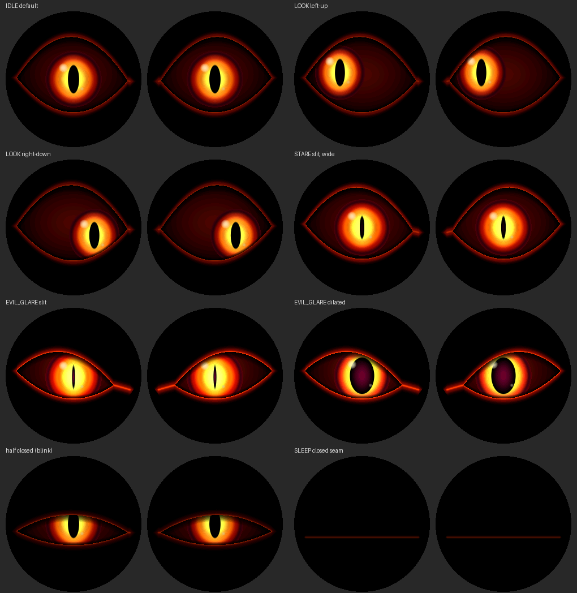
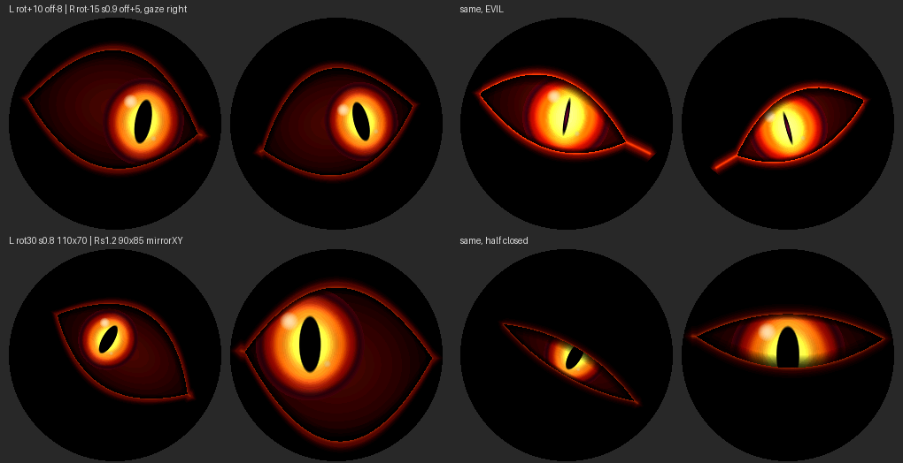

# Pumpkin Demon Eyes – animated demon eyes for a Halloween pumpkin

**English** | [Deutsch](README.de.md)

Two round 1.28" TFTs (GC9A01, 240 × 240) driven by a **Seeed Studio XIAO ESP32-C3** show two
glowing, demonic eyes. They blink, look around, stare, flare up in an evil glare and fall
asleep, fully autonomously, with no sensors and no WiFi.

The eyes are drawn **entirely procedurally**: every pixel is computed from formulas (lid
curves, ellipses, colour gradients). There are no GIFs, bitmaps or image sequences.
Position, size, rotation and mirroring of each eye are set **exclusively in `src/Config.h`**,
so you can match the geometry of your 3D-printed pumpkin.



*Image: renderer preview computed on a PC, not a photo. In each pair, display 1 is on the left
and display 2 on the right, with a round mask like the glass.*

---

## Contents

1. [Project status](#1-project-status)
2. [Hardware](#2-hardware)
3. [Wiring and pinout](#3-wiring-and-pinout)
4. [Supply voltage and logic levels](#4-supply-voltage-and-logic-levels)
5. [Why these pins? (strapping pins, SPI clock)](#5-why-these-pins)
6. [Choice of library](#6-choice-of-library)
7. [Installation, building, uploading](#7-installation-building-uploading)
8. [Operating modes: test, calibration, animation](#8-operating-modes)
9. [Aligning the eyes – via `Config.h` only](#9-aligning-the-eyes)
10. [Colours, glow, animation](#10-colours-glow-animation)
11. [Software architecture](#11-software-architecture)
12. [Rendering, performance, memory](#12-rendering-performance-memory)
13. [Known limitations](#13-known-limitations)

---

## 1. Project status

| Item | Status |
|---|---|
| PlatformIO build (`pio run`) | **successful**: RAM 33,220 B (10.1 %), flash 372,030 B (28.4 %). No warnings in the project code, even with `-Wall -Wextra -Wformat -Wsign-compare`. |
| Test on real hardware | **successful**: XIAO ESP32-C3 with two GC9A01 modules, shared SPI bus, shared DC/RST |
| Frame rate | smooth at the default limit of **24 FPS** (`TARGET_FPS`), SPI clock 40 MHz |

On a new build, run the [hardware test](#81-hardware-test-appmodehardwaretest) first after
flashing.

---

## 2. Hardware

| Component | Details |
|---|---|
| Microcontroller | Seeed Studio XIAO ESP32-C3: RISC-V single core, 160 MHz, 400 KB SRAM, 4 MB flash, **no FPU** |
| Display 1 (left eye) | 1.28" round, GC9A01, 240 × 240, 4-wire SPI |
| Display 2 (right eye) | identical |
| Power | USB-C (5 V, e.g. a power bank) |

In this project, "left" and "right" always mean the view of a **person standing in front of the
pumpkin**. Display 1 is the left eye, display 2 the right eye.

---

## 3. Wiring and pinout

Both displays share **one SPI bus**. SCK, MOSI, DC and RST are shared, and **each display has
its own CS line**. MISO is not needed because the displays are only written to.

> GC9A01 modules often label the SPI lines like I²C: **SCL = SPI clock (SCK)**,
> **SDA = SPI data (MOSI)**. This has nothing to do with I²C.

### Display 1 – left eye

| Display pin | XIAO pin | GPIO | Note |
|---|---|---|---|
| VCC | 3V3 | – | see [section 4](#4-supply-voltage-and-logic-levels) |
| GND | GND | – | |
| SCL (SCK) | D4 | GPIO6 | **shared** with display 2 |
| SDA (MOSI) | D5 | GPIO7 | **shared** with display 2 |
| CS | D1 | GPIO3 | display 1 only |
| DC | D2 | GPIO4 | **shared** with display 2 |
| RST / RES | D3 | GPIO5 | **shared** with display 2 |
| BL / BLK (if present) | D7 | GPIO20 | optional, off by default (`PIN_BACKLIGHT = -1`), see note below |

### Display 2 – right eye

| Display pin | XIAO pin | GPIO | Note |
|---|---|---|---|
| VCC | 3V3 | – | |
| GND | GND | – | |
| SCL (SCK) | D4 | GPIO6 | shared |
| SDA (MOSI) | D5 | GPIO7 | shared |
| CS | **D10** | **GPIO10** | display 2 only |
| DC | D2 | GPIO4 | shared |
| RST / RES | D3 | GPIO5 | shared |
| BL / BLK (if present) | D7 | GPIO20 | optional, shared |

### All GPIOs at a glance

| XIAO | GPIO | Use | Note |
|---|---|---|---|
| D0 | GPIO2 | free (right `RST` only with separate lines) | **strapping pin** |
| D1 | GPIO3 | CS display 1 | |
| D2 | GPIO4 | DC (both) | |
| D3 | GPIO5 | RST (both) | |
| D4 | GPIO6 | SPI SCK (both) | native FSPICLK pin (IO_MUX) |
| D5 | GPIO7 | SPI MOSI (both) | native FSPID pin (IO_MUX) |
| D6 | GPIO21 | free (right `DC` only with separate lines) | UART TX, prints the ROM log at boot |
| D7 | GPIO20 | backlight (optional) | UART RX, free because Serial runs over USB |
| D8 | GPIO8 | **free** | strapping pin |
| D9 | GPIO9 | **free** | strapping pin, BOOT button |
| D10 | GPIO10 | CS display 2 | |

All pins are defined in one place in `src/Config.h` (`PIN_SPI_SCLK`, `PIN_SPI_MOSI`,
`PIN_TFT_CS_LEFT`, `PIN_TFT_CS_RIGHT`, `PIN_TFT_DC`, `PIN_TFT_RST`, `PIN_BACKLIGHT`, …).

### Diagram

```
                 XIAO ESP32-C3 (top view, USB up)
                      ┌──────[USB-C]──────┐
     (free)   D0/GPIO2│●                 ●│5V
  CS disp.1   D1/GPIO3│●                 ●│GND ──────────── GND  disp.1 + disp.2
  DC both     D2/GPIO4│●                 ●│3V3 ──────────── VCC  disp.1 + disp.2
  RST both    D3/GPIO5│●                 ●│D10/GPIO10  CS disp.2
  SCK both    D4/GPIO6│●                 ●│D9/GPIO9    (free, BOOT)
  MOSI both   D5/GPIO7│●                 ●│D8/GPIO8    (free, strapping)
     (free)  D6/GPIO21│●                 ●│D7/GPIO20   BL both (optional)
                      └───────────────────┘
```

### Separate DC or RST lines (optional)

Shared DC/RST lines are the default and work with this firmware. If you still want to separate
them, set `SHARED_DC = false` and/or `SHARED_RST = false` in `Config.h`. Display 2 then uses
`PIN_TFT_DC_RIGHT` (D6/GPIO21) or `PIN_TFT_RST_RIGHT` (D0/GPIO2).

---

## 4. Supply voltage and logic levels

**Check your specific module before applying power.** GC9A01 modules come in several
variants:

- **With a voltage regulator** (often a small SOT-23 regulator marked "662K" on the back; the
  module is then usually labelled "3.3V/5V"): VCC may be 3.3 V or 5 V. Waveshare also specifies
  3.3 V/5 V for its 1.28" module.
- **Without a regulator**: VCC goes straight to the panel. Only **3.3 V** is allowed here.

Recommendation: **connect VCC to the XIAO's 3V3 pin**. This works with both variants. Two
modules typically draw less than 100 mA together (Waveshare states about 31 mA per module), and
the XIAO's 3.3 V regulator supplies enough current as long as the ESP32-C3 runs without WiFi.

**Logic levels:** The ESP32-C3 uses 3.3 V logic, and the GC9A01's logic inputs are designed for
3.3 V. The modules' signal lines are usually **not 5 V tolerant**, so never connect a 5 V
microcontroller without a level shifter. With the XIAO, **no** level shifters are needed.

**Backlight (BL/BLK):**
- Many modules switch the LED through a transistor and have a pull-up on the BL pin. If you
  leave BL open, the display simply lights up. That is the default (`PIN_BACKLIGHT = -1`).
- If you want PWM brightness control, connect both BL pins to D7 and set
  `PIN_BACKLIGHT = 20`. **Caution:** if your module has **no** transistor and BL drives the LED
  directly, do not connect BL directly to a GPIO. Use a small transistor or tie BL to 3V3.

**Power inside the pumpkin:** a USB-C power bank on the XIAO. Some power banks switch off at
very low current, but with two glowing displays this is rarely a problem.

---

## 5. Why these pins?

**Strapping pins avoided.** According to the Seeed wiki and the ESP32-C3 datasheet, GPIO2, GPIO8
and GPIO9 are strapping pins. Their level at reset decides the boot mode. GPIO9 is connected to
the BOOT button: low at start-up means download mode. A connected display could pull these
levels and prevent booting or uploading. That is why the default pinout uses **none** of these
three pins. In particular, SCK is **not** on D8/GPIO8, even though the Seeed pinout labels it
"SCK".

**Native SPI pins for the clock.** On the ESP32-C3, GPIO6 (FSPICLK) and GPIO7 (FSPID) are the
fixed IO_MUX pins of the SPI2 controller. According to the ESP-IDF documentation, IO_MUX allows
80 MHz, while the freely routable GPIO matrix (D8/D10) is limited to 40 MHz. The firmware starts
at a safe **40 MHz**, but the native pin choice keeps the door open for 80 MHz
([section 12.3](#123-turbo-80-mhz-spi-untested)).

**MISO not used.** The displays are write-only, which leaves D9 (strapping pin + BOOT) free.

---

## 6. Choice of library

**Chosen: [LovyanGFX](https://github.com/lovyan03/LovyanGFX) 1.2.35.**
All classes and functions used were checked against the source code of this version.

| Requirement | LovyanGFX |
|---|---|
| GC9A01 | dedicated panel class `lgfx::Panel_GC9A01` (with GC9A01-specific init and "no NOP" workaround) |
| ESP32-C3 | `lgfx::Bus_SPI` with GDMA DMA for the C3 |
| Two independent displays | any number of `LGFX_Device` instances, configured entirely **in code**, no global setup file |
| Shared SPI bus | both panels can use **the same** `Bus_SPI` object (shared DC) |
| Efficient transfer | `setWindow()` + `writePixelsDMA()` send your own pixel buffers via DMA directly, without copying |
| Shapes and text | `drawLine`, `drawCircle`, `fillTriangle`, `drawString` … for test and calibration screens |
| RAM | no frame buffer needed; LovyanGFX only reserves a DMA line buffer (≈ 480 B) per panel |

**Rejected:**
- **TFT_eSPI**: supports the GC9A01 and the ESP32-C3. However, its configuration lives globally
  in `User_Setup.h` and describes exactly *one* display. Two displays only work by toggling CS
  manually, which the author says is not intended. Per-display positions and rotations would be
  hard to keep cleanly separated.
- **Arduino_GFX**: also supports the GC9A01 and multiple displays. LovyanGFX was preferred
  because its DMA output of user buffers and its behaviour on a shared bus could be fully
  traced in the source code.

**Extra configuration file?** No. LovyanGFX is configured in `src/DisplayManager.cpp`, and all
values come from `src/Config.h`.

**Three quirks the firmware takes care of** (verified in the library source):
1. **Shared reset:** LovyanGFX pulls each panel's RST pin during `init()`. With a shared RST
   line, initialising display 2 would reset display 1 again. The panels therefore get
   `pin_rst = -1`, and the `DisplayManager` generates **one** reset pulse for both.
2. **Shared DC:** Both panels share **one** `Bus_SPI` object, which keeps the bus's DMA state
   consistent.
3. **SPI lock:** The Arduino core's transaction lock is not recursive. A transaction must never
   be open on both displays at the same time, otherwise the program hangs. The `DisplayManager`
   therefore always closes one transaction before opening the other.

---

## 7. Installation, building, uploading

### 7.1 PlatformIO

1. Install [Visual Studio Code](https://code.visualstudio.com/).
2. Install the **PlatformIO IDE** extension in VS Code.
3. Open the `Pumpkin-Demon-Eyes` folder in VS Code (*File → Open Folder*).

### 7.2 Libraries

Nothing to install manually: `platformio.ini` contains

```ini
lib_deps = lovyan03/LovyanGFX@^1.2.35
```

PlatformIO downloads LovyanGFX automatically on the first build. The `espressif32` platform
(6.x, Arduino core 2.0.17) is installed automatically as well.

### 7.3 Building

Click **Build** (✓) in the PlatformIO toolbar, or in a terminal:

```bash
pio run
```

### 7.4 Uploading to the XIAO ESP32-C3

Connect the XIAO via USB-C, then **Upload** (→), or:

```bash
pio run -t upload
```

If no port shows up or the upload fails: **hold BOOT, briefly press RESET, release BOOT** and
upload again. Then press RESET once.

### 7.5 Serial monitor

```bash
pio device monitor
```

Output runs over USB CDC at 115200 baud. You will see the init report, the geometry check of
both eyes, every state change and, every 5 s, a statistics line:

```
[stats] 24.0 fps | frame avg 30.1 ms max 33.8 ms | render L 14.8 ms R 14.9 ms | heap free … | IDLE
```

*(The numbers only illustrate the format; they are not a measurement.)*

---

## 8. Operating modes

Select the mode in `src/Config.h`:

```cpp
constexpr AppMode APP_MODE = AppMode::Animation;   // or HardwareTest, Calibration
```

### 8.1 Hardware test (`AppMode::HardwareTest`)

One run of six steps, each announced on the serial monitor. Afterwards the test starts over.

| Step | Display shows | What you check |
|---|---|---|
| 1 | display 1 **red**, display 2 black | display 1 and its CS line (GPIO3) |
| 2 | display 1 black, display 2 **green** | display 2 and its CS line (GPIO10) |
| 3 | display 1 **blue**, display 2 **yellow** | independent control, colour order (`DISPLAY_RGB_ORDER`), inversion (`DISPLAY_INVERT`) |
| 4 | "TOP" arrow, "L1"/"R2", yellow square top left | display rotation (`DISPLAY_ROTATION_*`) |
| 5 | eye + calibration overlay | position, radius, eye rotation, mirroring |
| 6 | animation demo of all states | IDLE, LOOK_AROUND, BLINK, DOUBLE_BLINK, STARE, EVIL_GLARE, SLEEP, WAKE_UP incl. FPS output |

Typical symptoms:
- **Both displays show the same image:** CS lines swapped or connected together.
- **One display stays dark:** check CS, VCC/GND or the backlight of that display.
- **Colours inverted (black turns white):** toggle `DISPLAY_INVERT`.
- **Red and blue swapped:** `DISPLAY_RGB_ORDER = true`.
- **Only noise:** SCK/MOSI swapped or `SPI_WRITE_FREQ_HZ` too high.

### 8.2 Calibration (`AppMode::Calibration`)

For mounting in the pumpkin. Each display shows a **still eye** with an overlay. Every 1.8 s
the gaze direction changes (centre, left, right, up, down, diagonal, half closed, "evil"), so
you can also see the pupil's movement limits.

| Colour | Element |
|---|---|
| grey | visible circle of the display, display centre cross, display axes (not rotated) |
| cyan (left) / magenta (right) | eye centre (circle), eye axes (**rotate with the eye**), eye outline, pupil travel limit (dimmed) |
| arrow on the eye axis | local **+x** direction = inner corner (nose side) of the design; points the other way when mirrored |
| triangle above the eye | "top" of the eye |
| orange | arc from the display horizontal to the eye axis = configured eye rotation |
| yellow | bounding box of the area actually drawn |
| text | current values `c=`, `off=`, `r=`, `scale=`, `rot=`, `mirror=` |

The firmware also prints the render area of each eye on the serial monitor. It **warns** if
the eye extends beyond the visible circle, i.e. gets cut off.

### 8.3 Animation (`AppMode::Animation`)

Normal operation. After power-on the pumpkin "wakes up" (WAKE_UP); afterwards the states change
randomly, but according to fixed weights (see [10.4](#104-behaviour-and-states)).

---

## 9. Aligning the eyes

### 9.1 The parameters

Each eye has its own block in `Config.h`:

```cpp
constexpr EyeGeometryConfig LEFT_EYE_CONFIG = {
    120, 120,         // centerX, centerY
    0.0f, 1.0f,       // rotationDeg, scale
    100.0f, 78.0f,    // radiusX, radiusY
    0, 0,             // offsetX, offsetY
    false, false      // mirrorX, mirrorY
};
```

| Parameter | Unit | Meaning |
|---|---|---|
| `centerX`, `centerY` | display pixels | nominal eye centre; 120/120 = display centre |
| `offsetX`, `offsetY` | display pixels | mounting correction, added **after** rotation; + = right/down |
| `rotationDeg` | degrees | additional rotation of the eye image; **+ = clockwise** |
| `scale` | factor | uniform size (1.0 = design size) |
| `radiusX` | eye units | half width of the eye opening (distance centre → eye corner) |
| `radiusY` | eye units | height of the upper lid arc; the lower one is `EYE_LOWER_LID_RATIO` (0.78) of it |
| `mirrorX`, `mirrorY` | – | mirrors the eye's **shape** (slanted lids, inner corner) |

**How do radius and scale work together?** The size on the display is **`radius × scale`**.
`radiusX`/`radiusY` define the **shape** (wide/narrow); `scale` enlarges or shrinks the whole
eye including iris, pupil, halo and lid rim. The two do not overlap or contradict each other: use
the radii for the shape and `scale` for fitting.

**Transformation order** (local eye coordinates → display), implemented centrally in
`EyeTransform` (`src/EyeGeometry.cpp`):

1. local coordinate (u, v), origin = eye centre
2. mirroring (`mirrorX`, `mirrorY`)
3. scaling (`scale`)
4. rotation (`rotationDeg`, clockwise)
5. translation to (`centerX + offsetX`, `centerY + offsetY`)
6. clipping to the display and the visible circle

Gaze, pupil, blinking and glow are all computed **locally**; the transformation only happens
when drawing. That is why you can change the geometry freely without changing the animation.

### 9.2 Concrete examples

All examples change **only** `Config.h`. Upload again afterwards (`pio run -t upload`).

**Move the left eye 8 pixels up:**
```cpp
constexpr EyeGeometryConfig LEFT_EYE_CONFIG = {
    120, 120,  0.0f, 1.0f,  100.0f, 78.0f,  0, -8,  false, false };
//                                           ^^^^ offsetY = -8
```

**Move the right eye 5 pixels down:**
```cpp
constexpr EyeGeometryConfig RIGHT_EYE_CONFIG = {
    120, 120,  0.0f, 1.0f,  100.0f, 78.0f,  0, 5,  true, false };
```

**Rotate the left eye 10° clockwise and the right eye 15° counter-clockwise:**
```cpp
// left:  rotationDeg = 10.0f      right: rotationDeg = -15.0f
```

**Shrink one eye to 90 %:** `scale = 0.9f`

**Make one eye a little wider and the other a little narrower:**
```cpp
// left:  radiusX = 106.0f        right: radiusX = 94.0f
```

**Mirror an eye horizontally:** `mirrorX = true`. The right eye is mirrored by default, so that
the slanted lids in EVIL_GLARE point symmetrically towards the nose.

**Display opening set at an angle** (e.g. the whole display sits 12° rotated and 6 px too far
right in the pumpkin): compensate the rotation with `rotationDeg = -12.0f` and the offset with
`offsetX = -6`. If the display is turned by 90°, use the display rotation
(`DISPLAY_ROTATION_*`) instead of a large angle.

A selection of these settings looks like this (preview computed on a PC):



### 9.3 Procedure after mounting

1. Set `APP_MODE = AppMode::HardwareTest` and upload. Check that both displays work and that
   the arrow in step 4 points up. If not, change `DISPLAY_ROTATION_LEFT` or `_RIGHT`.
2. Set `APP_MODE = AppMode::Calibration` and upload.
3. Look at the pumpkin from the viewer's position:
   - Eye centre not in the middle of the opening → change `offsetX`/`offsetY`.
   - Eye axis tilted relative to the opening → change `rotationDeg` (+ = clockwise).
   - Eye too large or small for the opening → change `scale`; eye too wide or too tall →
     change `radiusX`/`radiusY`.
   - The arrow (inner corner) should point towards the nose on both eyes; otherwise toggle
     `mirrorX`.
4. Watch the serial monitor for warnings (`eye area exceeds the visible circle …`).
5. When everything fits: `APP_MODE = AppMode::Animation`.

### 9.4 Display rotation ≠ eye rotation

| | Display rotation | Eye rotation |
|---|---|---|
| Parameter | `DISPLAY_ROTATION_LEFT`, `DISPLAY_ROTATION_RIGHT` | `rotationDeg` in `EyeGeometryConfig` |
| Values | 0–3 = 0/90/180/270° clockwise, 4–7 = additionally mirrored | any, e.g. 7.5° |
| Effect | rotates the panel's whole coordinate system (hardware, LovyanGFX `setRotation()`) | rotates only the drawn eye within the display |
| Purpose | rough mounting orientation (display upside down or sideways) | fine alignment to the opening |

The eye rotation changes neither the display orientation, nor the SPI output, nor the
LovyanGFX coordinates. It exists only in the renderer's transformation.

**Defaults:** `DISPLAY_ROTATION_LEFT = 3` and `DISPLAY_ROTATION_RIGHT = 1`. This matches the
reference pumpkin, in which both displays are mounted turned by 90° (left counter-clockwise,
right clockwise). If your displays are upright, set both values to 0. If an image is upside
down or mirrored, swap 1 and 3 for that display.

### 9.5 Mirroring and gaze direction

Mirroring reverses the **shape** (lid slant, inner corner, lid seam). Gaze direction and light
reflex, however, stay **screen-consistent**: when both eyes look "to the right", they both look
to the right even when one is mirrored, and the reflex sits at the top left on both.
`Eye::lookAt()` converts the shared gaze direction into each eye's local frame for this.

Rotation alone does **not** change the gaze direction separately: the pupil moves in the local
frame of the rotated eye, as befits an eye mounted at an angle.

`mirrorY` also reverses the closing direction of the lids, because the lid seam is then at the
top. This is intended but rarely needed.

### 9.6 Visible area

The firmware only draws pixels inside the circle defined by `DISPLAY_VISIBLE_CENTER_X/Y` and
`DISPLAY_VISIBLE_RADIUS` (default 120/120, r = 120). If your pumpkin covers the edge, you can
reduce the radius. If an eye lies partly outside, it is cut off cleanly. There are no memory
accesses outside valid ranges, because the row spans are clipped to the display and the circle
in advance. The firmware limits extreme values for `scale`/`radius` automatically and reports
this on the serial monitor.

---

## 10. Colours, glow, animation

### 10.1 Colours

All colours are defined as `0xRRGGBB` in `Config.h`, section *COLOURS*:

| Constant | Part of the eye | Default |
|---|---|---|
| `COLOR_BACKGROUND` | everything outside the eye | black |
| `COLOR_LID_RIM` | glowing lid edge, lid seam while asleep | orange-red |
| `COLOR_HALO` | glow around the eye opening | dark red |
| `COLOR_SCLERA_CENTER` / `_EDGE` | eyeball, centre and edge | dark blood red → almost black |
| `COLOR_IRIS_INNER` / `_MID` / `_OUTER` / `_RIM` | iris from inside to outside | yellow-orange → orange → blood red → dark violet-red |
| `COLOR_PUPIL` | pupil | black |
| `COLOR_PUPIL_CORE` | glowing pupil core (EVIL_GLARE) | dark violet-red |
| `COLOR_GLOW` | light around the pupil | bright yellow |
| `COLOR_HIGHLIGHT` | light reflexes | warm white |

Example for **green witch eyes**: `COLOR_IRIS_INNER = 0xD8FF40`, `COLOR_IRIS_MID = 0x60E000`,
`COLOR_IRIS_OUTER = 0x108000`, `COLOR_GLOW = 0xF0FFB0`, `COLOR_HALO = 0x0A5000`,
`COLOR_LID_RIM = 0x60FF20`.

### 10.2 Glow

| Constant | Effect |
|---|---|
| `GLOW_INTENSITY_SCALE` | overall brightness of all glowing parts |
| `GLOW_PUPIL_STRENGTH` | light around the pupil |
| `GLOW_HALO_STRENGTH`, `GLOW_RIM_STRENGTH` | halo and lid edge |
| `GLOW_FLICKER_AMOUNT` | ember-like flicker (0 = steady) |
| `GLOW_FIRE_RINGS`, `GLOW_FIRE_AMOUNT`, `GLOW_FIRE_SPEED` | fire rings moving outwards through the iris |
| `GLOW_IDLE`, `GLOW_STARE`, `GLOW_EVIL`, `GLOW_SLEEP` | glow strength per state |
| `BACKLIGHT_BRIGHTNESS` | backlight (only with the BL pin connected) |

The glow is produced by colour gradients in lookup tables, not by expensive per-pixel effects
([section 12](#12-rendering-performance-memory)).

### 10.3 Speed

| Constant | Effect |
|---|---|
| `ANIM_GAZE_SPEED` | factor for **all** eye movements (0.7 = 30 % faster, 1.5 = more sluggish) |
| `ANIM_PUPIL_SPEED` | factor for pupil changes |
| `SACCADE_BASE_MS`, `SACCADE_MS_PER_UNIT` | quick gaze jumps |
| `GLIDE_MS_MIN/MAX` | slow, creeping looks |
| `SNAP_MS` | aggressive twitch with overshoot |
| `MICRO_SACCADE_*` | tiny fixation movements |
| `BLINK_*` | duration of each blink type, interval `BLINK_INTERVAL_MIN/MAX_MS`, `DOUBLE_BLINK_CHANCE` |
| `OPENNESS_MIN/MAX` | range of normal eye opening (excluding blinking and sleeping) |
| `IDLE_OPENNESS_MIN/MAX` | eye opening in the IDLE state (default 0.70–0.82; lower = sleepier, lurking look) |
| `*_MS_MIN/MAX` | duration of each state |
| `RANDOM_SEED` | 0 = different every time, otherwise a reproducible sequence |

### 10.4 Behaviour and states

| State | Behaviour |
|---|---|
| `IDLE` | calm, lively gaze with slow drifting and occasional gaze jumps; sometimes an **eerie still phase** (no micro movement, no blinking) that ends with a sudden jump |
| `LOOK_AROUND` | glances in all directions (left, right, up, down, diagonal, centre, positions in between) as quick saccades, slow creeping glides or aggressive twitches |
| `BLINK` | blink: normal, fast, closed for a while, or heavy and slow |
| `DOUBLE_BLINK` | two quick blinks |
| `STARE` | wide open, pupils narrow to slits, frozen gaze, slight cross-eyed convergence, one pulse of the pupils |
| `EVIL_GLARE` | sudden twitch, slanted lowered lids, slit pupil **or** suddenly huge pupil, glowing pupil core, flickering glow, single lid twitch on one eye only |
| `SLEEP` | lids droop, reluctantly open once more, then close completely; the lid seam smoulders and "breathes" |
| `WAKE_UP` | slow opening, wide pupils, double blink, first look around |

The transitions are defined as the weight matrix `TRANSITION_WEIGHTS` in `Config.h`
(row = current state, column = next state). For more evil glares, for example, raise the
values in the `EVIL` column. If the pumpkin should never sleep, set the `SLEEP` column to 0.

**Liveliness:** both eyes receive the same commands with small random delays
(`EYE_LAG_MS_MAX`). With probability `EYE_INDEPENDENT_CHANCE`, one eye reacts noticeably later
and slightly offset, i.e. briefly on its own. Pupil size and glow vary minimally per eye.

---

## 11. Software architecture

```
src/
├─ Config.h                 central configuration (hardware, geometry, colours, animation)
├─ main.cpp                 setup()/loop(), mode selection, frame limiter
├─ App.h/.cpp               object bundle + FPS/timing statistics
│
├─ DisplayManager.h/.cpp    display init (LovyanGFX), shared bus/reset, DMA strips
├─ EyeGeometry.h/.cpp       EyeTransform (local ↔ display), EyeShape, row spans, pupil limits
├─ EyeRenderer.h/.cpp       procedural fixed-point rendering, double-buffered DMA
├─ EyePalette.h/.cpp        colour gradients → RGB565 lookup tables (glow, flicker, fire rings)
│
├─ EyeState.h               interface animation → renderer (local, normalised, no geometry)
├─ Eye.h/.cpp               eye model: combines the three controllers
├─ GazeController.h/.cpp    eye movement (saccades, glides, micro movements)
├─ BlinkController.h/.cpp   blinking, eye opening, lid tension ("anger")
├─ PupilController.h/.cpp   pupil size/shape, glow, hippus, flicker
├─ AnimationController.h/.cpp  state machine for both eyes
├─ Tween.h/.cpp             easing curves + time-based value animator (millis())
├─ Random.h/.cpp            xorshift32 random numbers, weighted choice
│
├─ Calibration.h/.cpp       calibration mode + overlay and orientation screens
└─ TestMode.h/.cpp          hardware diagnostic sequence
```

**Data flow per frame:**

```
AnimationController ──commands──► Eye (gaze/blink/pupil controllers) ──► EyeRenderState (local, normalised)
                                                                            │
EyeGeometryConfig ──► EyeGeometry (transform, spans) ──────────────────► EyeRenderer ──► DisplayManager ──DMA──► GC9A01
```

- **Geometry and animation are separate:** the animation only knows `EyeRenderState` with
  normalised, local values. Position, size, rotation and mirroring live exclusively in
  `EyeGeometry` and only take effect in the renderer.
- **Nothing blocks:** all timing compares `millis()` timestamps. `delay()` only appears in
  `setup()` (display reset pulse), never in the animation loop.
- **Extending:** a new state needs an entry in `AnimState`, an `enter…/update…` function pair in
  `AnimationController.cpp` and, if it should be chosen automatically, a row and column in
  `TRANSITION_WEIGHTS`.

---

## 12. Rendering, performance, memory

### 12.1 Strategy

An RGB565 full frame costs 115,200 B per display. Two of them do not fit sensibly into memory.
On top of that, transferring both full frames at 40 MHz would take about 46 ms, which limits the
frame rate to roughly 21 FPS. The firmware therefore works **without a frame buffer**:

1. **Row spans:** At start-up, `EyeGeometry` computes for every display row which x range the
   (rotated, scaled) eye including its halo can touch at all. The result is clipped to the
   display and the visible circle. Only this area is redrawn each frame; the black rest is never
   sent again. With the default geometry this is about **30,500 pixels per eye** instead of
   57,600.
2. **Double-buffered strips:** Drawing happens in two strips of 8 rows each
   (240 × 8 × 2 B = 3.8 KB each). While one strip is sent to the display via **DMA**, the CPU
   computes the next one.
3. **Inverse transformation, fixed point:** For every pixel, the inverse affine mapping yields
   the local eye coordinate. Because the mapping is affine, this costs only **two additions per
   pixel**, no matter how far the eye is rotated or scaled, so arbitrary angles come at no extra
   cost. The ESP32-C3 has **no FPU**, so the pixel loop uses 32-bit fixed point only. Floats are
   used just once per frame to compute the coefficients.
4. **Lookup tables instead of per-pixel effects:** Iris glow, halo, lid edge, eyeball and pupil
   core are small RGB565 tables, generated once per frame from the colours in `Config.h`
   (integer arithmetic only). Each pixel just reads a table entry. Alpha blending is used in
   only a few places (pupil edge, light reflexes, lid shadow).
5. **No flicker:** Every pixel is sent exactly once per frame with its final colour. There is no
   "clear and redraw".
6. The pixel loop lives in IRAM, and the code is compiled with `-O2`.

### 12.2 Performance

On the reference build the animation runs smoothly at the default limit `TARGET_FPS = 24`
(SPI 40 MHz, default geometry). Each frame computes and transfers about 61,000 pixels (two
eyes); at 40 MHz the SPI transfer alone takes about 24 ms.

The firmware prints the actual values every 5 s in animation and test mode
(`[stats] … fps | frame avg … | render L … R …`). For a higher frame rate, try:
- reducing `scale` slightly (the pixel count drops quadratically),
- reducing `EYE_HALO_WIDTH`,
- 80 MHz (next section), then raising `TARGET_FPS`.

Strong rotations do **not** cost extra pixels, because the spans follow the rotated ellipse.

### 12.3 Turbo: 80 MHz SPI (untested)

```cpp
constexpr uint32_t SPI_WRITE_FREQ_HZ = 80000000;
constexpr bool     SPI_FORCE_IOMUX   = true;
```

Background: the Arduino SPI driver routes the pins through the GPIO matrix, which ESP-IDF
specifies for 40 MHz. After init, `SPI_FORCE_IOMUX` switches GPIO6/GPIO7 to the direct IO_MUX
path (`gpio_iomux_out`), just as ESP-IDF itself does for native pins. Whether your display
module (panel, wire length, wiring) handles 80 MHz cleanly can only be found out by trying. If
you see noise, go back to 40 MHz. Short wires help.

### 12.4 Memory

| Item | Size |
|---|---|
| total static RAM (per build output, incl. Arduino core) | 33,220 B of 327,680 B |
| DMA strip buffers | 2 × 3,840 B = 7.5 KB |
| colour tables per eye | ≈ 2.4 KB |
| row spans per eye | 960 B |
| LovyanGFX DMA line buffer | ≈ 480 B per panel |
| full-frame buffer | **none** (would cost 115 KB per display) |
| dynamic allocations in the animation loop | **none** |

---

## 13. Known limitations

- **No tearing protection:** GC9A01 modules usually do not expose the TE pin. During very fast
  gaze jumps, a horizontal edge may briefly be visible (tearing, not flicker).
- **No read access to the displays:** without MISO there is no way to check whether a display is
  actually connected. "init sequence sent" in the log only means it was sent. The colour test
  provides the proof.
- **80 MHz SPI and `SPI_FORCE_IOMUX` are untested** and therefore off by default.
- **Lid distances are approximated:** the distance to the lid edge is measured vertically in the
  local frame, and with a diamond metric beyond the eye corners. With very narrow eyes, the lid
  rim looks a little thinner at the tips.
- **Shared backlight:** both displays always have the same backlight brightness.
- **Value ranges:** `scale` 0.1–4, `radiusX/Y` 8–400, `center` −240…480, `offset` ±240, aspect
  ratio `radiusY` between `radiusX/3` and `1.5 × radiusX`. The firmware limits values outside
  these ranges and reports this on the serial monitor.
- **`DISPLAY_ROTATION` 4–7** mirror via the panel hardware. They are independent of
  `mirrorX/Y`, and combining both can be confusing. Values 0–3 are enough for normal
  orientations.

---

*Hardware references:
[Seeed Wiki XIAO ESP32-C3](https://wiki.seeedstudio.com/XIAO_ESP32C3_Getting_Started/) ·
[ESP-IDF SPI Master (ESP32-C3)](https://docs.espressif.com/projects/esp-idf/en/v4.4.7/esp32c3/api-reference/peripherals/spi_master.html) ·
[Waveshare 1.28" LCD Module](https://www.waveshare.com/wiki/1.28inch_LCD_Module) ·
[LovyanGFX](https://github.com/lovyan03/LovyanGFX)*
